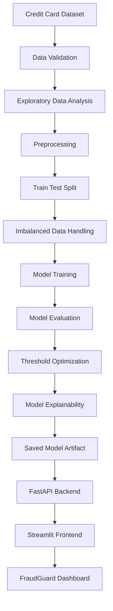

# 🛡️ FraudGuard — Credit Card Fraud Detection System

<p align="center">
  <strong>Detect Today. Safer Tomorrow.</strong>
  <br/>
  An end-to-end Machine Learning application for identifying potentially fraudulent credit card transactions.
</p>

<p align="center">
  
  
  
  
  
  
</p>

---

## 🚀 Overview

Credit card fraud is a major challenge for financial institutions. Detecting suspicious transactions is difficult because fraudulent transactions represent only a tiny fraction of overall transaction activity.

**FraudGuard** is an end-to-end machine learning project designed to identify potentially fraudulent credit card transactions using classification algorithms.

The project combines data validation, exploratory data analysis, preprocessing, imbalanced-class handling, model training, evaluation, explainability, REST API development and an interactive dashboard.

It demonstrates how a machine learning model can be transformed into an application that users can interact with.

## ✨ Key Features

| Feature | Description |
|---|---|
| 📊 Interactive Dashboard | Monitor dataset statistics and transaction patterns |
| 🔍 Single Prediction | Enter transaction details and predict fraud probability |
| 📁 Batch Prediction | Upload a compatible CSV and generate multiple predictions |
| 💳 Transaction Explorer | Explore and filter transactions by type and amount |
| 📈 Model Performance | View classification metrics and confusion matrix |
| 🧠 Model Explainability | Explore feature importance and SHAP insights |
| 🔌 REST API | Access predictions through FastAPI endpoints |
| 🧪 Automated Testing | Validate project structure, dataset and core functionality |

## 🖥️ Application Preview

Add your actual application screenshots in the `docs/screenshots/` directory and update these image paths.

| Dashboard | Single Prediction |
|---|---|
|  |  |

| Batch Prediction | Model Performance |
|---|---|
|  |  |

## 🏗️ System Architecture



## 🧠 Machine Learning Workflow

1. **Data Validation:** Check dataset structure, missing values, duplicates and target distribution.
2. **Exploratory Data Analysis:** Investigate transaction patterns, fraud distribution and feature relationships.
3. **Preprocessing:** Prepare features for machine learning.
4. **Class Imbalance Handling:** Apply SMOTE to training data where appropriate.
5. **Model Training:** Train and compare classification models.
6. **Model Evaluation:** Evaluate precision, recall, F1-score, ROC-AUC and PR-AUC.
7. **Threshold Optimization:** Select a classification threshold based on fraud detection requirements.
8. **Explainability:** Use feature importance and SHAP to understand model behaviour.

> Important: SMOTE must be applied only within training folds, never before splitting the dataset. Final test data must remain untouched.

## 📊 Model Evaluation

FraudGuard evaluates the model using metrics suitable for highly imbalanced classification problems.

| Metric | Purpose |
|---|---|
| Precision | How many predicted fraud transactions were actually fraudulent? |
| Recall | How many actual fraud transactions were detected? |
| F1-score | Balance between precision and recall |
| ROC-AUC | Ability to distinguish between classes |
| PR-AUC | Precision-recall performance, especially useful for rare fraud cases |
| Confusion Matrix | Shows true positives, false positives, true negatives and false negatives |

**Evaluation artifacts:** `reports/metrics/`

The dashboard reads performance information from the saved model and evaluation artifacts. Refer to the generated test metrics rather than treating accuracy alone as evidence of model quality.

## 🛠️ Technology Stack

| Category | Technologies |
|---|---|
| Programming | Python |
| Data Processing | Pandas, NumPy |
| Machine Learning | Scikit-learn, Imbalanced-learn |
| Visualization | Matplotlib, Seaborn |
| Explainable AI | SHAP |
| Backend | FastAPI, Uvicorn |
| Frontend | Streamlit |
| Testing | Pytest |
| Model Storage | Joblib |
| Development | Jupyter Notebook, VS Code, Git, GitHub |

## 📂 Project Structure

```text
Credit-card-fraud-detection/
│
├── api/
│   └── main.py
│
├── app/
│   └── streamlit_app.py
│
├── configs/
│   └── config.yaml
│
├── data/
│   ├── raw/
│   └── processed/
│
├── models/
│
├── notebooks/
│   ├── baseline_models.ipynb
│   ├── data_validation.ipynb
│   ├── eda.ipynb
│   └── model_training.ipynb
│
├── reports/
│   ├── figures/
│   └── metrics/
│
├── src/
│   └── fraud_detection/
│       ├── __init__.py
│       ├── config.py
│       ├── data.py
│       └── models.py
│
├── tests/
│   ├── test_data.py
│   └── test_project.py
│
├── .gitignore
├── Dockerfile
├── LICENSE
├── README.md
└── requirements.txt
```

## ⚙️ Installation & Setup

### 1. Clone the repository

```bash
git clone https://github.com/ajity202/Credit-card-fraud-detection.git
cd Credit-card-fraud-detection
```

### 2. Create a virtual environment

Windows:

```bash
python -m venv .venv
.venv\Scripts\activate
```

### 3. Install dependencies

```bash
pip install -r requirements.txt
```

### 4. Download the dataset

The original dataset is available on Kaggle:

[Credit Card Fraud Detection Dataset — Machine Learning Group, ULB](https://www.kaggle.com/datasets/mlg-ulb/creditcardfraud)

Download `creditcard.csv` and place it here:

```text
data/raw/creditcard.csv
```

The dataset is not committed to this repository because of GitHub's file-size limit.

### 5. Run the FastAPI backend

```bash
uvicorn api.main:app --host 127.0.0.1 --port 8001 --reload
```

API documentation:

```text
http://127.0.0.1:8001/docs
```

### 6. Run the Streamlit frontend

Make sure the frontend API URL points to:

```python
API_URL = "http://127.0.0.1:8001"
```

Then run:

```bash
streamlit run app/streamlit_app.py --server.port 8501
```

Open the application:

```text
http://localhost:8501
```

> The trained model artifact must be available in `models/` before starting the API. Follow the notebook training workflow to generate it.

## 🔌 API Endpoints

| Method | Endpoint | Description |
|---|---|---|
| GET | `/` | API status |
| GET | `/health` | Health check |
| GET | `/model-info` | Model information |
| POST | `/predict` | Single transaction prediction |
| POST | `/predict-batch` | Batch JSON prediction |
| POST | `/predict-batch-csv` | CSV batch prediction |
| GET | `/feature-importance` | Feature importance |
| GET | `/shap-importance` | SHAP importance |
| GET | `/dataset-info` | Dataset statistics |
| GET | `/metrics` | Model evaluation metrics |

Interactive API documentation: `/docs`

## 🧪 Run Tests

Run the automated test suite:

```bash
python -m pytest tests -v
```

## 📌 Dataset Information

The project uses the publicly available European credit card transactions dataset.

- 284,807 transactions
- 492 fraudulent transactions
- 284,315 legitimate transactions
- 30 input features
- 1 target column (`Class`)

The features `V1` to `V28` are anonymized PCA-transformed features.

**Dataset source:** [Kaggle — Credit Card Fraud Detection](https://www.kaggle.com/datasets/mlg-ulb/creditcardfraud)

## 🔮 Future Improvements

- Advanced model comparison and hyperparameter optimization
- Cost-sensitive fraud detection
- Improved temporal validation
- Real-time transaction monitoring
- Model drift detection
- Cloud deployment and CI/CD
- Authentication and role-based access
- Production-grade logging and monitoring

## 🎯 Project Objectives

This project explores the complete machine learning development lifecycle, from raw data to an interactive application.

It aims to demonstrate practical skills in:

- Data Science and Machine Learning
- Handling highly imbalanced datasets
- Model evaluation and explainable AI
- Backend API development
- Interactive dashboard development
- Software testing and project organization

## 👨‍💻 Author

**Ajit Yadav**

Data Science Graduate | MSc Artificial Intelligence Student | Aspiring Data Scientist

Interested in Machine Learning, Artificial Intelligence, Data Analytics and building practical technology solutions.

- GitHub: [@ajity202](https://github.com/ajity202)
- LinkedIn: [Connect with me](https://www.linkedin.com/)

If you find this project interesting, feel free to explore the repository, share your feedback or connect with me!

## ⭐ Support the Project

If FraudGuard helped you understand an end-to-end machine learning workflow:

- ⭐ Star this repository
- 🍴 Fork it and experiment
- 💬 Open an issue with suggestions
- 🤝 Share your feedback

Your feedback and contributions are welcome!

---

<p align="center">
  <strong>FraudGuard — Detect Today. Safer Tomorrow. 🛡️</strong>
  <br/>
  <sub>Built with Python, Machine Learning, FastAPI and Streamlit.</sub>
</p>
