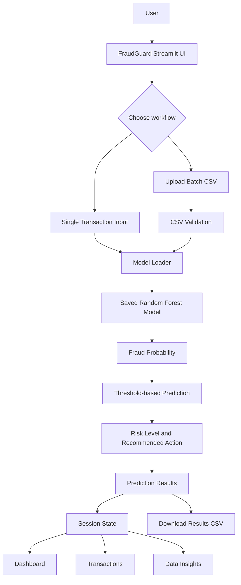

# 🛡️ FraudGuard — Credit Card Fraud Detection System

<p align="center">
  <strong>Detect Today. Safer Tomorrow.</strong><br>
  An end-to-end machine learning application for identifying potentially fraudulent credit card transactions.
</p>

<p align="center">
  
  
  
  
  
</p>

<p align="center">
  <a href="https://fraud-guard63.streamlit.app/">🚀 Live Demo</a> ·
  <a href="https://github.com/ajity202/Credit-card-fraud-detection">GitHub Repository</a>
</p>

---

## 🚀 Overview

Credit card fraud detection is a challenging classification problem because fraudulent transactions represent only a very small fraction of overall transaction activity.

**FraudGuard** is a machine learning project that predicts whether a credit card transaction may be fraudulent. It brings together data validation, exploratory data analysis, preprocessing, class-imbalance handling, model training and evaluation, model serialization, and an interactive Streamlit application.

The deployed application supports single-transaction prediction and batch CSV prediction. After a batch file is processed, its predictions and dataset summaries are available across the Dashboard, Transactions, and Data Insights pages for the current Streamlit session.

> **Note:** FraudGuard is an educational portfolio project and decision-support demonstration. It is not a banking-grade fraud prevention service.

## ✨ Key Features

| Feature | Description |
|---|---|
| 📊 Interactive Dashboard | View active dataset totals, predicted fraud counts, transaction trends, and amount summaries |
| 🔍 Single Prediction | Enter transaction features and estimate fraud probability |
| 📁 Batch Prediction | Upload a compatible CSV and generate predictions for multiple transactions |
| 🔄 Shared Batch Results | Use the processed upload across Dashboard, Transactions, and Data Insights during the same session |
| 💳 Transaction Explorer | Explore and filter the active transaction dataset |
| 📈 Model Performance | View saved evaluation metrics, confusion-matrix information, and feature importance where available |
| 🧠 Model Explainability | Display available feature-importance and SHAP artifacts |
| 📥 Download Results | Export batch predictions as a CSV file |

## 🌐 Live Application

**Try FraudGuard:** https://fraud-guard63.streamlit.app/

The application is hosted on Streamlit Community Cloud. The Streamlit app loads the saved model artifact directly; a separately running local FastAPI server is not required for the deployed Streamlit application.

## 🖥️ Application Preview

Add your latest application screenshots to `docs/screenshots/` and update these paths when the images are committed.

| Dashboard | Batch Prediction |
|---|---|
|  |  |

| Single Prediction | Model Performance |
|---|---|
|  |  |

## 🏗️ Application Architecture



## 📁 Batch CSV Testing

You can test the deployed application without uploading the full Kaggle dataset.

### Download the sample file

Use the included smoke-test file:

**[`data/sample_transactions.csv`](data/sample_transactions.csv)**

It contains 10 synthetic transaction rows and all 30 model input columns:

- `Time`
- `V1` through `V28`
- `Amount`

The sample file intentionally does not include a `Class` column. FraudGuard generates its own predictions for the uploaded rows.

> **Important:** These are synthetic placeholder values intended to verify CSV upload, feature validation, model inference, dashboard updates, and result export. They are not real card transactions, a representative evaluation dataset, or evidence of model accuracy. The predictions are model outputs and are not guaranteed to contain a fraud-positive example.

### Test the sample in the live app

1. Open the [FraudGuard live application](https://fraud-guard63.streamlit.app/).
2. Select **Batch Prediction** from the sidebar.
3. Upload `sample_transactions.csv`.
4. Confirm that the file preview and row count appear.
5. Click **Generate Predictions**.
6. Review the prediction summary, fraud probability, risk level, and transaction results.
7. Navigate to **Dashboard** to see the uploaded batch reflected in the overview and charts.
8. Open **Transactions** and **Data Insights** to explore the active uploaded batch.
9. Return to Batch Prediction and use **Download Prediction Results** to export the output CSV.

### Expected application behaviour

| Action | Expected behaviour |
|---|---|
| Upload a compatible CSV | The file is parsed and its required columns are validated |
| Generate Predictions | FraudGuard calculates a probability and class prediction for each row |
| Open Dashboard | Active batch totals and prediction-based summaries are shown |
| Open Transactions | Uploaded rows and prediction status are available for inspection |
| Open Data Insights | Charts and amount summaries use the uploaded batch where the required columns exist |
| Upload another valid CSV | The new file replaces the active batch for the current session |
| Download results | A CSV containing the original input columns and prediction output columns is provided |

**Session behaviour:** Uploaded data and predictions are held in Streamlit session state. They are available while navigating pages in the same active session, but they are not permanently stored, shared with other visitors, or guaranteed to survive a session reset or app restart.

### CSV format required by the model

The uploaded CSV must contain these exact feature columns:

```text
Time,V1,V2,V3,V4,V5,V6,V7,V8,V9,V10,
V11,V12,V13,V14,V15,V16,V17,V18,V19,V20,
V21,V22,V23,V24,V25,V26,V27,V28,Amount
```

- All 30 feature columns are required.
- Feature values must be numeric and non-missing.
- `Class` is optional. If present, it is retained as a reference column and is not used as a model input.
- The `V1`–`V28` columns are anonymized PCA-transformed features from the original dataset. Arbitrary values from unrelated datasets are not compatible with the model's feature semantics.

## 🧠 Machine Learning Workflow

1. **Data Validation:** Check dataset structure, missing values, duplicates, and target distribution.
2. **Exploratory Data Analysis:** Investigate transaction patterns, class distribution, and feature relationships.
3. **Preprocessing:** Prepare transaction features for machine learning.
4. **Class Imbalance Handling:** Apply SMOTE to training data where appropriate.
5. **Model Training:** Train and compare classification models.
6. **Model Evaluation:** Evaluate precision, recall, F1-score, ROC-AUC, and PR-AUC.
7. **Threshold Optimization:** Select a classification threshold based on fraud-detection requirements.
8. **Explainability:** Use feature importance and SHAP artifacts where available.
9. **Model Serialization:** Save the trained model and related metadata.
10. **Application Integration:** Load the saved model in the Streamlit application for single and batch inference.

> **Methodological note:** SMOTE must be applied only to training data, ideally inside a cross-validation pipeline. Validation and final test data must remain untouched.

## 📊 Model Evaluation

FraudGuard focuses on metrics appropriate for imbalanced classification:

| Metric | Purpose |
|---|---|
| Precision | Of the transactions predicted as fraud, how many were actually fraud? |
| Recall | Of all actual fraud transactions, how many were detected? |
| F1-score | Harmonic balance between precision and recall |
| ROC-AUC | Ability to rank positive cases above negative cases |
| PR-AUC | Precision-recall performance, especially useful for rare fraud cases |
| Confusion Matrix | Shows true positives, false positives, true negatives, and false negatives |

The deployed dashboard reads saved evaluation metrics from the model bundle. The model ROC-AUC displayed in the current deployed dashboard is **96.92%**. Refer to the saved test metrics and evaluation artifacts for the full evaluation context; do not interpret this value as a guarantee of real-world performance.

## 🛠️ Technology Stack

| Category | Technologies |
|---|---|
| Programming | Python |
| Data Processing | Pandas, NumPy |
| Machine Learning | Scikit-learn, Imbalanced-learn |
| Visualization | Matplotlib, Seaborn |
| Explainable AI | SHAP |
| Frontend / Deployment | Streamlit |
| API Development | FastAPI, Uvicorn (available in the project for API workflows) |
| Model Storage | Joblib |
| Testing | Pytest |
| Development | Jupyter Notebook, VS Code, Git, GitHub |

## 📂 Project Structure

```text
Credit-card-fraud-detection/
│
├── api/
│   └── main.py
│
├── app/
│   ├── backend.py
│   └── streamlit_app.py
│
├── configs/
│   └── config.yaml
│
├── data/
│   ├── raw/                 # Full reference dataset (not committed)
│   ├── processed/
│   └── sample_transactions.csv  # Small synthetic batch-test file
│
├── models/
│   └── fraud_model.joblib   # Trained model bundle
│
├── notebooks/
│   ├── baseline_models.ipynb
│   ├── data_validation.ipynb
│   ├── eda.ipynb
│   └── model_training.ipynb
│
├── reports/
│   ├── figures/
│   └── metrics/
│
├── src/
│   └── fraud_detection/
│
├── tests/
│
├── .gitignore
├── Dockerfile
├── LICENSE
├── README.md
└── requirements.txt
```

## ⚙️ Installation & Local Setup

### 1. Clone the repository

```bash
git clone https://github.com/ajity202/Credit-card-fraud-detection.git
cd Credit-card-fraud-detection
```

### 2. Create and activate a virtual environment

**Windows:**

```bash
python -m venv .venv
.venv\Scripts\activate
```

### 3. Install dependencies

```bash
pip install -r requirements.txt
```

If you are using the saved model bundle, ensure the dependencies required to load it (including `joblib`, NumPy, Pandas, and the compatible Scikit-learn version) are installed.

### 4. Run the Streamlit application

```bash
streamlit run app/streamlit_app.py
```

Open:

```text
http://localhost:8501
```

The saved model bundle must be present at the path expected by `app/backend.py`, currently `models/fraud_model.joblib`.

### Optional: Run the FastAPI backend

The project also contains a FastAPI API module for API-based workflows. If you want to run it locally:

```bash
uvicorn api.main:app --host 127.0.0.1 --port 8001 --reload
```

API documentation:

```text
http://127.0.0.1:8001/docs
```

The current Streamlit app performs model inference directly through `app/backend.py`; the optional API process is not required to run the Streamlit dashboard.

## ☁️ Streamlit Community Cloud Deployment

1. Push the project code and required deployment files to GitHub.
2. Open [Streamlit Community Cloud](https://share.streamlit.io/).
3. Connect the GitHub repository.
4. Select the `main` branch.
5. Set the app entrypoint to:

   ```text
   app/streamlit_app.py
   ```

6. Confirm that `requirements.txt` is in the repository root.
7. Confirm that the model bundle exists at `models/fraud_model.joblib` and is accessible to the deployment.
8. Deploy the application and review the app logs if dependency or model-loading errors occur.

Do not commit the full original Kaggle dataset or private transaction data. Keep deployment dependencies in `requirements.txt`.

## 📌 Original Dataset Information

The project uses the publicly available European credit card transactions dataset.

- 284,807 transactions
- 492 fraudulent transactions
- 284,315 legitimate transactions
- 30 input features
- 1 target column (`Class`)

The features `V1` to `V28` are anonymized PCA-transformed features.

**Dataset source:** [Kaggle — Credit Card Fraud Detection](https://www.kaggle.com/datasets/mlg-ulb/creditcardfraud)

The full dataset is not included in this repository because of its size. For training and reference-dataset analysis, download it from Kaggle and place it at:

```text
data/raw/creditcard.csv
```

## 🔐 Data Privacy & Responsible Use

- Do not upload real cardholder data, card numbers, CVVs, PINs, passwords, or personally identifiable financial information.
- Use anonymized, authorized data only.
- The included sample file is synthetic and intended for software testing.
- FraudGuard's prediction is a model-generated risk signal, not a confirmed fraud determination.
- Do not use this student project as the sole basis for approving, declining, or blocking real financial transactions.

## 🧪 Run Tests

Run the automated test suite from the project root:

```bash
python -m pytest tests -v
```

## 🔮 Future Improvements

- Advanced model comparison and hyperparameter optimization
- Cost-sensitive fraud detection
- Improved temporal validation
- Real-time transaction monitoring
- Model drift detection
- Authentication and role-based access
- Production-grade logging and monitoring
- Expanded automated testing and CI/CD

## 🎯 Project Objectives

FraudGuard explores the machine learning development lifecycle, from data preparation and model evaluation to an interactive deployed application.

It demonstrates practical skills in:

- Data Science and Machine Learning
- Handling highly imbalanced datasets
- Model evaluation and explainable AI
- Python application development
- Interactive dashboard development
- Model serialization and inference
- Software testing and project organization
- Cloud deployment using Streamlit Community Cloud

## 👨‍💻 Author

**Ajit Yadav**

Data Science Graduate | MSc Artificial Intelligence Student | Aspiring Data Scientist

Interested in Machine Learning, Artificial Intelligence, Data Analytics, and building practical technology solutions.

- GitHub: [@ajity202](https://github.com/ajity202)
- LinkedIn: [Connect with me](www.linkedin.com/in/ajit-yadav-245b36276)

If you find this project interesting, feel free to explore the repository, try the live demo, share feedback, or connect with me.

## ⭐ Support the Project

If FraudGuard helped you explore an end-to-end machine learning workflow:

- ⭐ Star this repository
- 🍴 Fork it and experiment
- 💬 Open an issue with suggestions
- 🤝 Share your feedback

Contributions and constructive feedback are welcome!

---

<p align="center">
  <strong>FraudGuard — Detect Today. Safer Tomorrow. 🛡️</strong><br>
  <sub>Built with Python, Machine Learning, and Streamlit.</sub>
</p>
