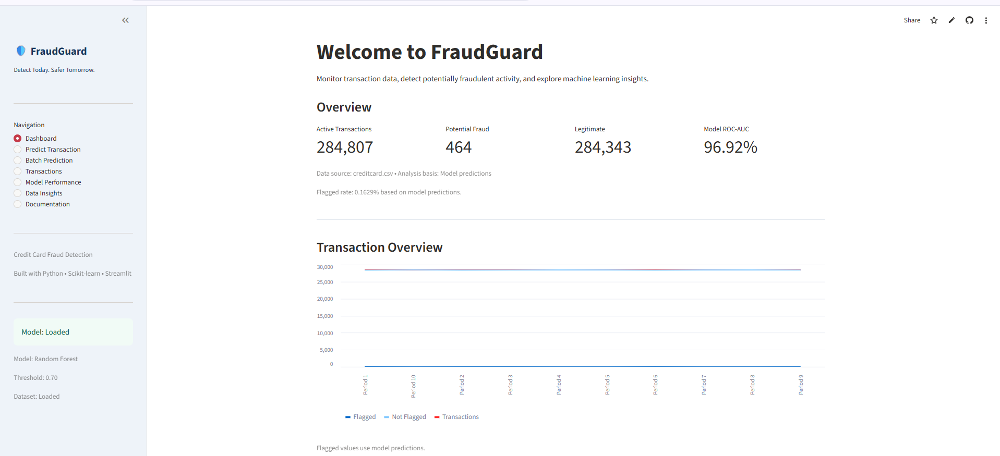
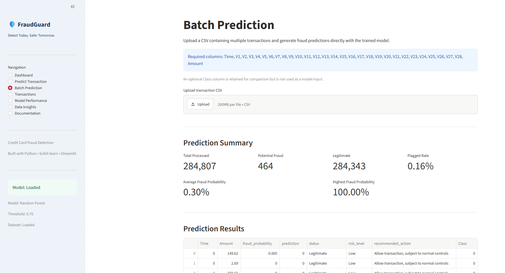
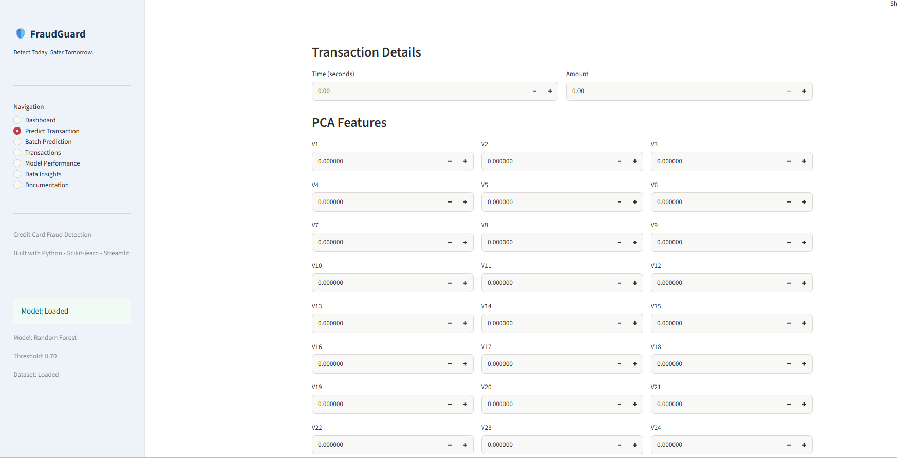
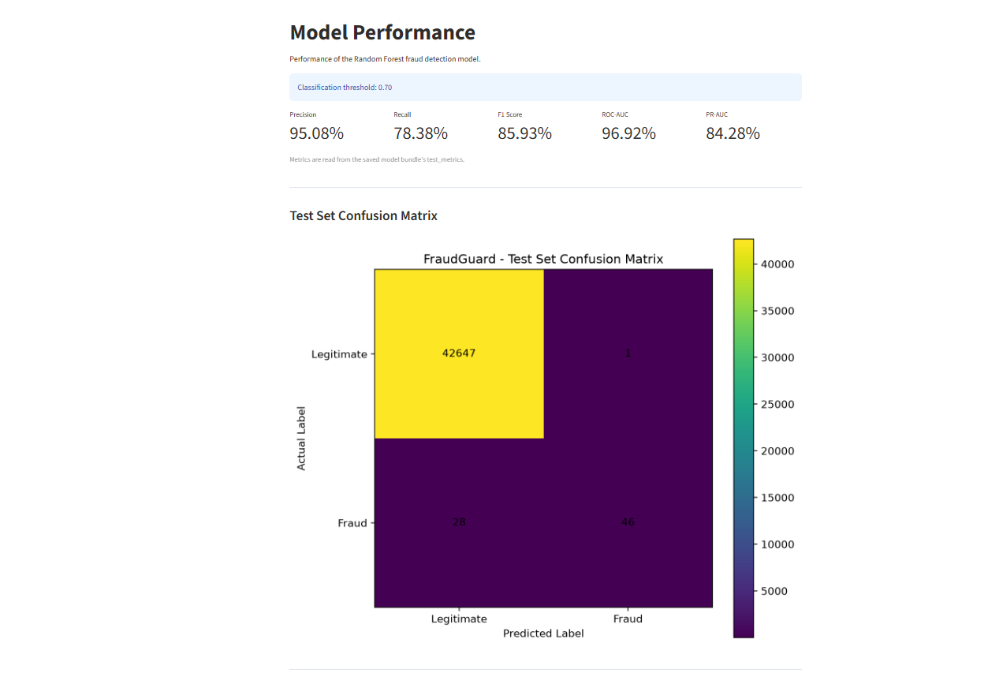
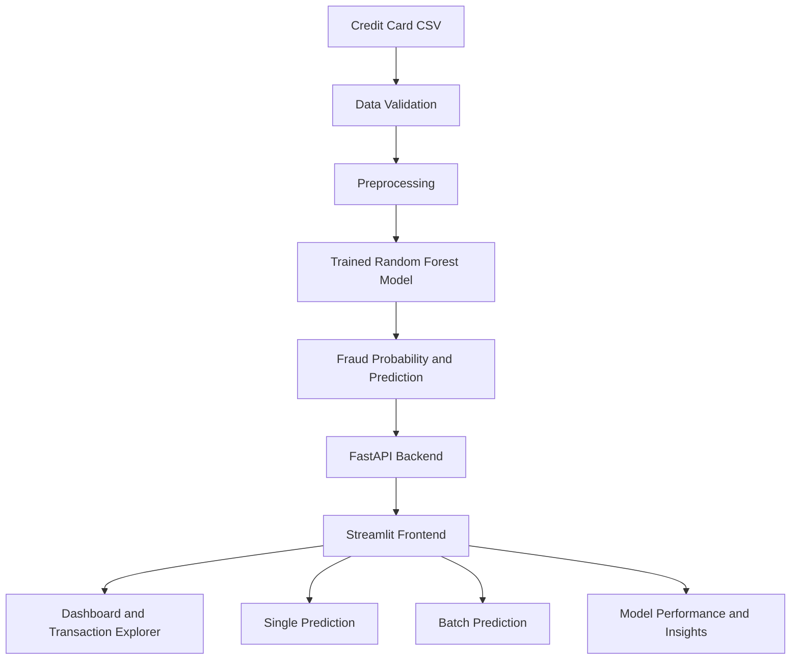

# 🛡️ FraudGuard — Credit Card Fraud Detection System

<p align="center">
  <strong>Detect Today. Safer Tomorrow.</strong><br/>
  An end-to-end machine learning application for identifying potentially fraudulent credit card transactions.
</p>

<p align="center">
  <a href="https://fraud-guard63.streamlit.app/"><strong>🚀 Try the Live App</strong></a>
  &nbsp;•&nbsp;
  <a href="https://github.com/ajity202/Credit-card-fraud-detection"><strong>📂 GitHub Repository</strong></a>
</p>

<p align="center">
  
  
  
  
  
  
</p>

---

## 🚀 Overview

Credit card fraud is difficult to detect because fraudulent transactions represent only a small fraction of all transaction activity.

**FraudGuard** is an end-to-end machine learning project that predicts potentially fraudulent credit card transactions. It brings together data validation, exploratory data analysis, preprocessing, imbalanced-class learning, model evaluation, a REST API and an interactive Streamlit application.

The project demonstrates how a trained machine learning model can be made accessible through a web application, including single-transaction and batch CSV prediction workflows.

## 🌐 Live Application

**[Open FraudGuard on Streamlit Cloud](https://fraud-guard63.streamlit.app/)**

The deployed application includes:
- Interactive dashboard
- Single transaction prediction
- Batch CSV prediction
- Transaction exploration
- Model performance metrics
- Data insights and documentation

> **Demo tip:** Use the sample file included in this repository (`creditcard_1.csv`) to test Batch Prediction. Upload it in the Batch Prediction section and generate predictions. The processed batch becomes the active dataset for the dashboard and other dataset-based sections during that app session.

## ✨ Key Features

| Feature | Description |
|---|---|
| 📊 Interactive Dashboard | View transaction counts, predicted fraud, legitimate transactions and transaction trends |
| 🔍 Single Prediction | Enter transaction details and receive a fraud prediction and probability |
| 📁 Batch Prediction | Upload a compatible CSV and generate predictions for multiple transactions |
| 💳 Transaction Explorer | Explore and filter processed transactions |
| 📈 Model Performance | Review precision, recall, F1-score, ROC-AUC, PR-AUC and the confusion matrix |
| 🧠 Model Insights | Explore model-related insights and feature importance where available |
| 🔌 REST API | Serve predictions through FastAPI endpoints |
| 🧪 Automated Testing | Run tests for core project functionality |

## 🖥️ Application Screenshots

### Dashboard


### Batch Prediction
Upload a CSV containing transaction features to generate predictions in bulk.



### Single Transaction Prediction
Enter the transaction time, amount and PCA-transformed feature values to get a prediction.



### Model Performance
The application displays the saved model's evaluation metrics and test-set confusion matrix.



---

## 🧪 Try It with the Included Sample Dataset

A small sample CSV is included in the repository for quick testing:

**File:** [`creditcard_1.csv`](creditcard_1.csv)

The sample contains **1,500 transactions**:
- 1,498 legitimate transactions (`Class = 0`)
- 2 fraudulent transactions (`Class = 1`)
- 30 model input features and 1 target column (`Class`)

### Test it on the live app

1. Open [FraudGuard](https://fraud-guard63.streamlit.app/).
2. Select **Batch Prediction** from the sidebar.
3. Download [`creditcard_1.csv`](https://raw.githubusercontent.com/ajity202/Credit-card-fraud-detection/main/creditcard_1.csv) from this repository if you do not already have it.
4. Upload the CSV.
5. Generate predictions.
6. Return to the Dashboard, Transactions or Data Insights sections to explore the processed batch.

### CSV format

The model expects these 30 input columns:

```text
Time, V1, V2, V3, ... V28, Amount
```

The `Class` column is optional. If included, it is retained for comparison but is **not** passed to the model as an input feature.

> **Important:** This is a small demonstration sample, not a representative dataset for model training or reliable performance evaluation. It contains only two fraud examples. Use the full dataset for serious experimentation and evaluation.

## 🗂️ Dataset Information

The project is based on the publicly available European credit card transactions dataset from the Machine Learning Group at Université Libre de Bruxelles (ULB).

The original dataset contains:
- 284,807 transactions
- 492 fraudulent transactions
- 284,315 legitimate transactions
- 30 input features
- 1 target column (`Class`)

Features `V1` to `V28` are anonymized PCA-transformed variables.

**Full dataset:** [Kaggle — Credit Card Fraud Detection](https://www.kaggle.com/datasets/mlg-ulb/creditcardfraud)

The full original dataset is not stored in this repository. The included `creditcard_1.csv` is a smaller sample for application testing.

## 🏗️ System Architecture



## 🧠 Machine Learning Workflow

1. **Data Validation:** Check the dataset structure, missing values, duplicates and target distribution.
2. **Exploratory Data Analysis:** Explore transaction patterns, class imbalance and feature relationships.
3. **Preprocessing:** Prepare the input features for model training.
4. **Class Imbalance Handling:** Use an imbalance-handling approach such as SMOTE on training data only.
5. **Model Training:** Train classification models, including the Random Forest model used by the application.
6. **Model Evaluation:** Evaluate precision, recall, F1-score, ROC-AUC and PR-AUC.
7. **Thresholding:** Apply the configured classification threshold to convert fraud probabilities into predictions.
8. **Deployment:** Load the saved model bundle and expose prediction functionality through the application.

> **Methodology note:** SMOTE must be applied only to training data (or inside training folds), never to the final test set. Keep test data untouched when evaluating model performance.

## 📊 Model Evaluation

The deployed Model Performance page reads the evaluation metrics saved with the model bundle.

| Metric | Current displayed result |
|---|---:|
| Precision | 95.08% |
| Recall | 78.38% |
| F1-score | 85.93% |
| ROC-AUC | 96.92% |
| PR-AUC | 84.28% |
| Classification threshold | 0.70 |

These are the saved test-set metrics shown in the current application screenshot. Results may differ if the model is retrained or the model bundle is replaced.

| Metric | What it tells us |
|---|---|
| Precision | How many transactions flagged as fraud were actually fraud |
| Recall | How many actual fraud transactions were detected |
| F1-score | Harmonic balance between precision and recall |
| ROC-AUC | How well the model separates the two classes across thresholds |
| PR-AUC | Precision-recall performance, particularly useful for rare fraud cases |
| Confusion Matrix | Counts correct and incorrect predictions for each class |

## 🛠️ Technology Stack

| Category | Technologies |
|---|---|
| Programming | Python |
| Data Processing | Pandas, NumPy |
| Machine Learning | Scikit-learn, Imbalanced-learn |
| Visualization | Matplotlib, Seaborn |
| Explainable AI | SHAP |
| Backend | FastAPI, Uvicorn |
| Frontend | Streamlit |
| Testing | Pytest |
| Model Storage | Joblib |
| Development | Jupyter Notebook, VS Code, Git, GitHub |

## 📂 Project Structure

```text
Credit-card-fraud-detection/
│
├── api/
│   └── main.py
├── app/
│   ├── backend.py
│   └── streamlit_app.py
├── configs/
├── data/
│   ├── raw/
│   └── processed/
├── models/
│   └── fraud_model.joblib
├── notebooks/
├── reports/
│   ├── figures/
│   └── metrics/
├── src/
│   └── fraud_detection/
├── tests/
├── docs/
│   └── screenshots/
├── creditcard_1.csv
├── Dockerfile
├── LICENSE
├── README.md
└── requirements.txt
```

## ⚙️ Run Locally

### 1. Clone the repository

```bash
git clone https://github.com/ajity202/Credit-card-fraud-detection.git
cd Credit-card-fraud-detection
```

### 2. Create and activate a virtual environment

**Windows:**

```bash
python -m venv .venv
.venv\Scripts\activate
```

**macOS / Linux:**

```bash
python3 -m venv .venv
source .venv/bin/activate
```

### 3. Install dependencies

```bash
pip install -r requirements.txt
```

### 4. Run the FastAPI backend

```bash
uvicorn api.main:app --host 127.0.0.1 --port 8001 --reload
```

API documentation:

```text
http://127.0.0.1:8001/docs
```

### 5. Run the Streamlit frontend

Make sure the frontend is configured to use the local API address:

```python
API_URL = "http://127.0.0.1:8001"
```

Start Streamlit in a second terminal:

```bash
streamlit run app/streamlit_app.py --server.port 8501
```

Open:

```text
http://localhost:8501
```

> The trained model bundle must be available in `models/` before starting the application. The included sample CSV is for batch prediction testing; it is not used to retrain the model.

## 🔌 API Endpoints

| Method | Endpoint | Description |
|---|---|---|
| GET | `/` | API status |
| GET | `/health` | Health check |
| GET | `/model-info` | Model information |
| POST | `/predict` | Single transaction prediction |
| POST | `/predict-batch` | Batch JSON prediction |
| POST | `/predict-batch-csv` | CSV batch prediction |
| GET | `/feature-importance` | Feature importance |
| GET | `/shap-importance` | SHAP importance |
| GET | `/dataset-info` | Dataset statistics |
| GET | `/metrics` | Model evaluation metrics |

Interactive API documentation is available at `/docs` when the API is running.

## 🧪 Run Tests

```bash
python -m pytest tests -v
```

## 🔮 Future Improvements

- More extensive model comparison and hyperparameter optimization
- Cost-sensitive fraud detection
- Improved temporal validation
- Real-time transaction monitoring
- Model drift detection
- CI/CD and deployment automation
- Authentication and role-based access
- Production-grade logging and monitoring

## 🎯 Project Objectives

FraudGuard explores the machine learning development lifecycle, from dataset validation and model evaluation to API development and interactive application deployment.

It demonstrates practical work in:
- Data science and machine learning
- Imbalanced classification
- Model evaluation and explainable AI
- REST API development
- Interactive dashboard development
- Testing and project organization

## 👨‍💻 Author

**Ajit Yadav**  
Data Science Graduate | MSc Artificial Intelligence Student | Aspiring Data Scientist

Interested in Machine Learning, Artificial Intelligence, Data Analytics and building practical technology solutions.

- GitHub: [@ajity202](https://github.com/ajity202)
- Project: [FraudGuard — Credit Card Fraud Detection](https://github.com/ajity202/Credit-card-fraud-detection)
- Live Demo: [fraud-guard63.streamlit.app](https://fraud-guard63.streamlit.app/)

## ⭐ Support the Project

If you find FraudGuard useful or interesting:

- ⭐ Star this repository
- 🍴 Fork it and experiment
- 💬 Open an issue with suggestions
- 🤝 Share feedback and ideas

Contributions and feedback are welcome!

---

<p align="center">
  <strong>FraudGuard — Detect Today. Safer Tomorrow. 🛡️</strong><br/>
  <sub>Built with Python, Machine Learning, FastAPI and Streamlit.</sub>
</p>
